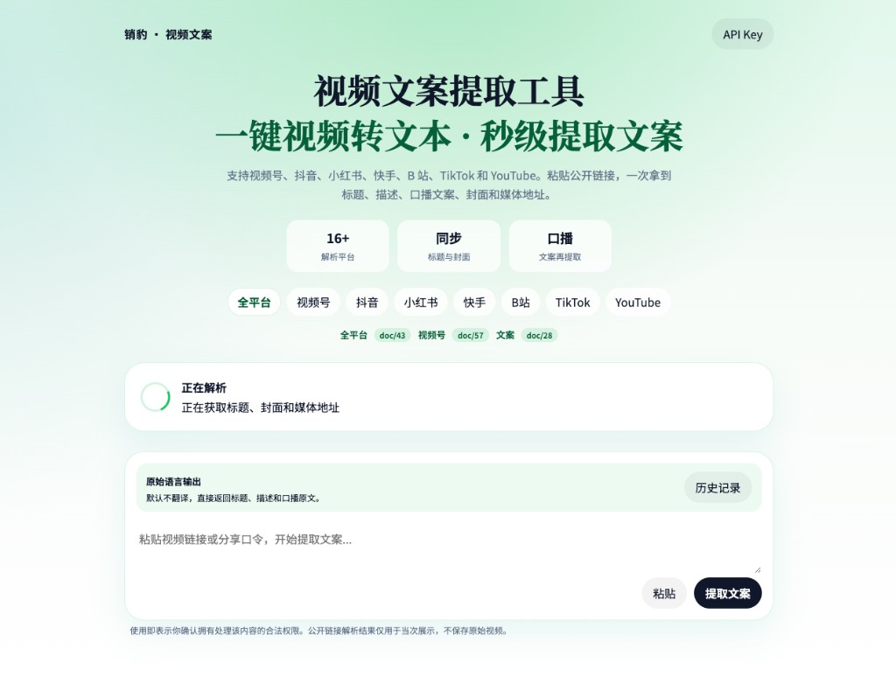

# 销豹视频文案

全平台视频解析的开源页面。体验和 [视频文案提取](https://xiaobao.ink/video-copy) 同一条路径：粘贴分享链接，先拿到标题、描述、封面和媒体地址，再提取口播文案。



接口直连 [销豹开放平台](https://xiaoapis.com)。密钥只留在你自己的电脑上。

| 能力 | 文档 | 接口 |
| --- | --- | --- |
| 抖音、快手、小红书、B 站、TikTok、YouTube 等 | [doc/43](https://xiaoapis.com/doc/43) | `/api/video/videoparse` |
| 微信视频号 | [doc/57](https://xiaoapis.com/doc/57) | `/api/video/weixin` |
| 口播文案 | [doc/28](https://xiaoapis.com/doc/28) | `/api/video/text` |

字段说明见 [docs/api.md](docs/api.md)。

## 启动

需要 Node.js 18 或更新版本。

```bash
npm start
```

打开 <http://127.0.0.1:8787>，把 [开放平台](https://xiaoapis.com/user/register) 申请的 API Key 填进页面。密钥存在本机浏览器里，不会写进仓库。

也可以放到环境变量，页面没填时由服务端使用：

```bash
export XIAOBAO_API_KEY="你的密钥"
npm start
```

## 怎么解析

1. 选平台，或直接粘贴分享口令。
2. 视频号链接走 doc/57，其余走 doc/43。
3. 解析结果里如果有视频或音频地址，可以继续提取口播文案。文案接口是异步的：先提交，再用任务号查询到 `resultText`。

解析结果的版权归原作者和原平台。这个项目只做链接解析，不保存、不转发原始视频。

## 测试

```bash
npm test
```
